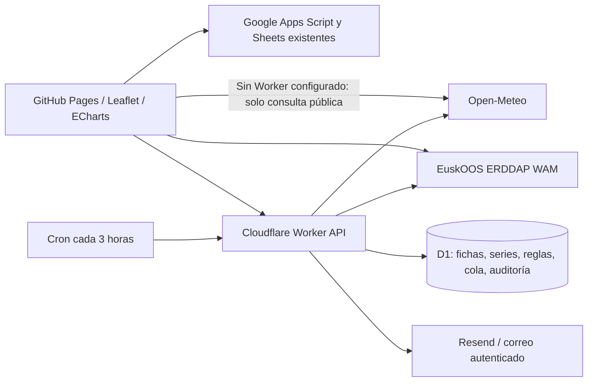

# Arquitectura y auditoría

Base recuperable: commit `e4d4008`, etiqueta local `backup/spearfishing-before-forecast-20261025`. Desarrollo: `feature/marine-forecast-alerts`.

La aplicación original no se ha sustituido. `app.js` sigue gestionando Leaflet, KML, formulario y cartografías; `photo-patch.js` conserva la lectura de Sheets y el envío de fotografías. Los módulos nuevos son ESM JavaScript con pruebas, sin compilación obligatoria del frontend. Se evita introducir TypeScript y un empaquetador en la aplicación heredada para reducir el alcance de la migración.

## Hallazgos de auditoría

| Hallazgo | Tratamiento |
|---|---|
| Dos URLs Apps Script; el parche reemplaza funciones y captura submit | Se conservan los contratos. Se elimina la primera lectura redundante de Sheets que podía competir con el parche. No se cambian registros remotos. |
| Funciones de fotos/formulario duplicadas | Se mantienen durante esta ampliación; su consolidación exige acceso y pruebas del Apps Script que no está en el repositorio. |
| HTML KML insertado sin escapar | Escape en popup y texto en información. URLs de fotos solo HTTPS. |
| EXIF truncado podía lanzar RangeError y dejar promesa sin resolver | Lectura protegida, devuelve ausencia de GPS. |
| Caché incluía cualquier respuesta externa | Nueva lista explícita de recursos propios. Las API nunca entran en caché. |
| Centro inicial en Galicia | Mundaka, preservando todos los polígonos y marcadores anteriores. |
| Fotos no-cors con respuesta opaca | Se conserva el mensaje de envío pendiente de confirmar por Apps Script. No se considera prueba de almacenamiento. |
| API heredada de escritura accesible públicamente | No se ha cambiado la autenticación de Apps Script para evitar romperla. Debe revisarse en ese servidor; el nuevo Worker no protege retrospectivamente ese endpoint. |

## Módulos

- `marine/providers.js`: adaptadores Open-Meteo, unidades SI, validación, datos parciales y procedencia.
- `marine/regional.js`: WAM regional con metadatos actuales, búsqueda limitada de celda y tiempos nativos.
- `marine/exposure.js`: intersecciones, rosa geométrica, comprobación orientada de costa y contrato de resultados de modelos anidados validados.
- `marine/conditions.js`: criterios, restricciones críticas, preferencias y ventanas continuas.
- `marine/alerts.js`: oportunidades, resúmenes diarios/semanales y empeoramiento con comparación previa.
- `worker/index.js`: API, D1, permisos, cron, bloqueo de concurrencia, cola e intentos.

## Persistencia

Migración `worker/migrations/0001_initial.sql`: contiene todas las entidades solicitadas y sus índices. Los lugares de previsión y los puntos originales están separados. La ficha piloto referencia `kml/sitios.kml`, `placemark:7` (índice cero), sin añadir un polígono duplicado al KML.

`forecast_runs.payload` conserva respuesta normalizada y procedencia. `forecast_values` se llena con valores individuales, unidad SI y fuente por variable; `forecast_quality` conserva incidencias. `local_estimates` registra explícitamente ausencia de estimación local calibrada. Sectores y parámetros se conservan dentro de la ficha JSON; las tablas de sectores/geometrías/parámetros están preparadas para su próxima normalización completa. `providers` y `admin_users` están reservadas: la versión inicial usa registro de proveedores en código y una credencial administrativa única de servidor.

Las series se conservan siete días; reglas, destinatarios y entregas no se borran automáticamente. Es necesario definir y ejecutar una política de conservación de datos personales antes de abrir suscripciones a terceros.

## Permisos y privacidad

Las rutas públicas consultan únicamente fichas con `public=1`, nunca aceptan coordenadas arbitrarias. Las fichas privadas requieren credencial y nunca se escriben a archivos estáticos. La credencial administrativa aleatoria de al menos 32 caracteres es un secreto Worker; el navegador solo la mantiene en memoria. Comparación por SHA-256 en tiempo constante, HTTPS, CORS de origen exacto, validación, SQL parametrizado, límite por IP/ruta/minuto y registro de modificaciones.

Modelo inicial de un administrador; no implementa sesiones multiusuario, roles ni MFA. Para un equipo, reemplazarlo por Cloudflare Access/OIDC verificado antes de ampliar acceso. Ninguna ruta pública de alta de destinatarios. La baja requiere POST tras una página de confirmación para evitar activación por escáneres de enlaces.

## Límites científicos

No hay SWAN, batimetría numérica, calibración de viento, propagación de oleaje ni corrientes estuarinas resueltas. El nivel SMOC es una predicción de nivel total referido al nivel medio global, no altura de marea referida a cero hidrográfico. Los extremos se aproximan en la serie horaria; no son un almanaque. No se afirma precisión observacional ni visibilidad submarina.
